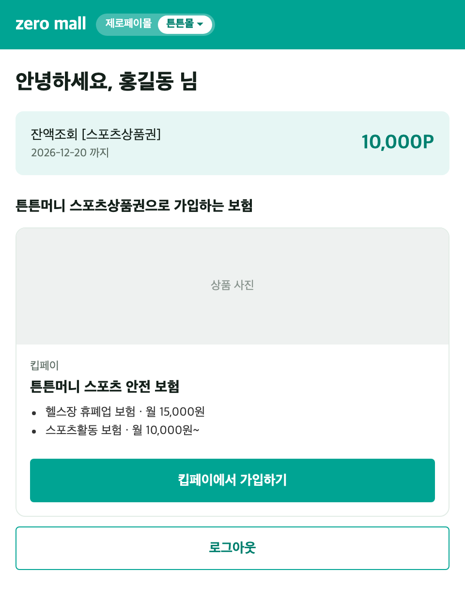
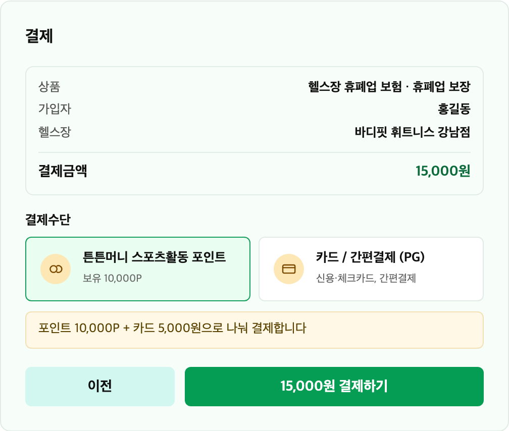
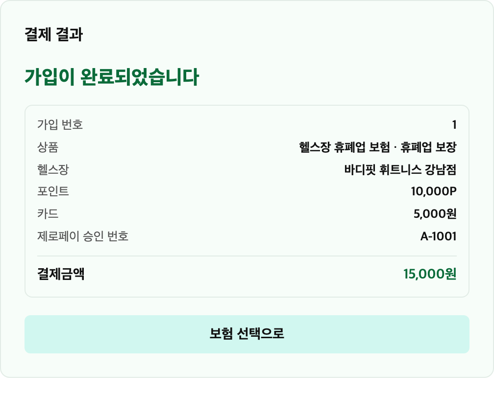
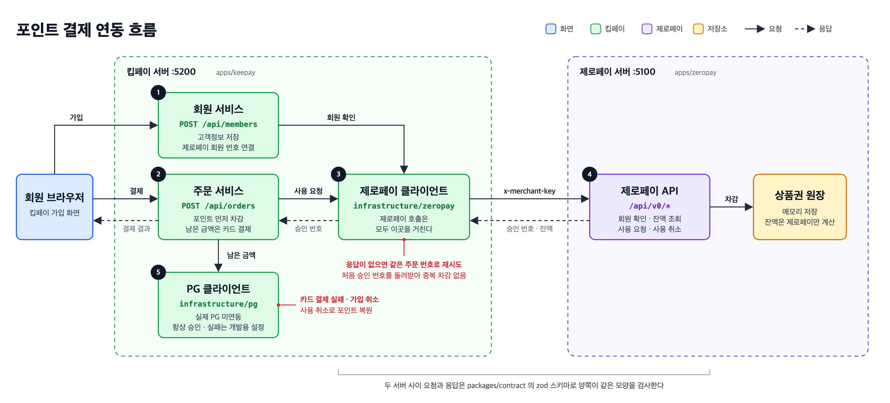
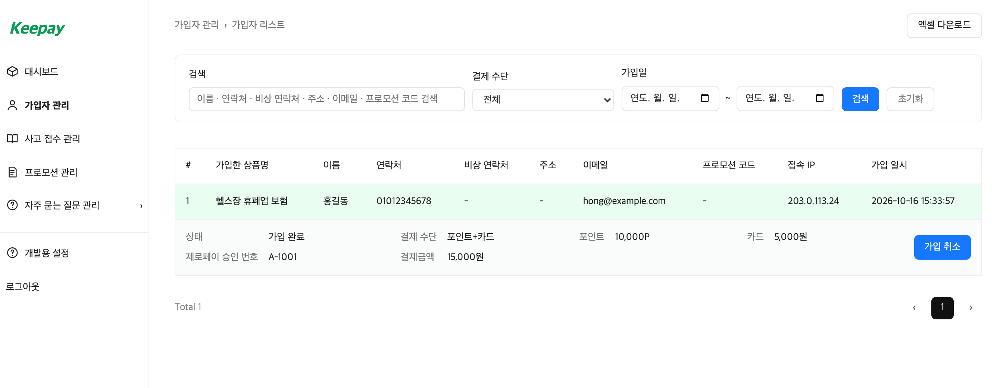
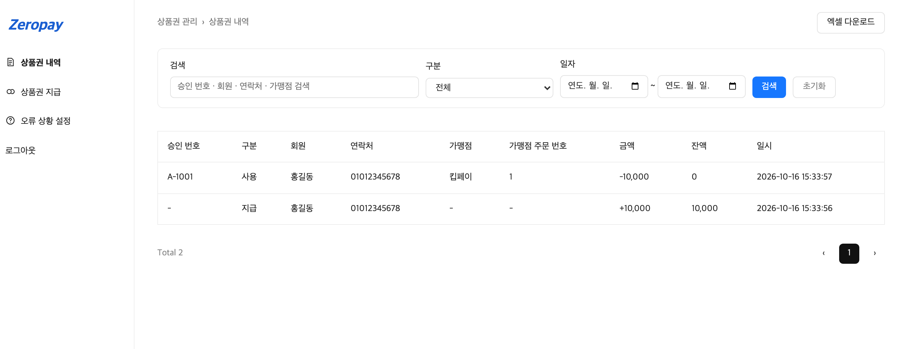
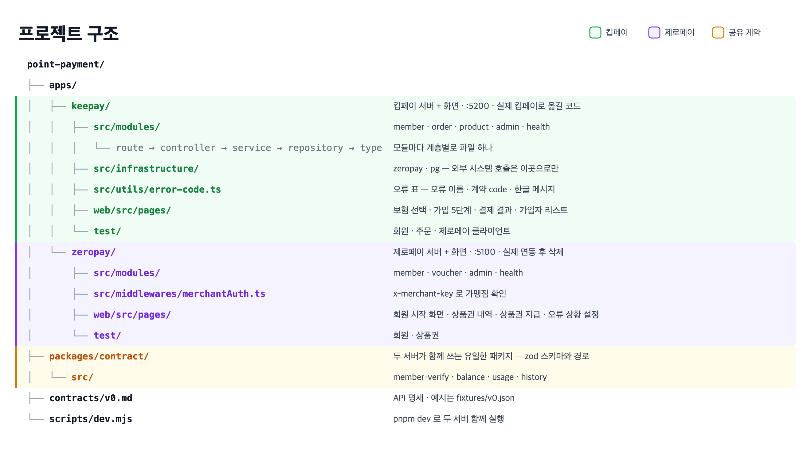

# point-payment

킵페이 보험 포인트 결제 Mock 환경

제로페이 스포츠상품권 포인트로 킵페이 보험료를 결제합니다. 포인트가 부족하면 남은 금액은 카드로 결제합니다 (복합 결제).

| 제로페이 잔액 | 결제 | 결제 완료 |
|:---:|:---:|:---:|
|  |  |  |

## 연동 흐름



API 명세는 [contracts/v0.md](contracts/v0.md)에 있습니다. 결제가 끝나면 두 운영자 화면에 같은 승인 번호가 남아 대조할 수 있습니다.

**킵페이 가입자 리스트**



**제로페이 상품권 내역**



## 실행

```bash
pnpm install
pnpm dev     # 킵페이 :5200 · 제로페이 :5100
pnpm test    # pnpm check 는 타입 검사
```

| 접속 | 주소 | 계정 |
|---|---|---|
| 회원 | http://localhost:5100 | customer1111 / customer1111 |
| 제로페이 운영자 | http://localhost:5100/admin | admin1234 / admin1234 |
| 킵페이 운영자 | http://localhost:5200/admin | admin1234 / admin1234 |

초기 포인트는 0P입니다. 제로페이 운영자 › 상품권 지급에서 먼저 지급하세요.

## 예외 시나리오

| 시나리오 | 설정 위치 | 기대 결과 |
|---|---|---|
| 사용 요청 응답 유실 | 제로페이 운영자 › 오류 상황 설정 | 같은 주문 번호로 재시도, 중복 차감 없음 |
| 사용 취소 실패 | 제로페이 운영자 › 오류 상황 설정 | 주문 상태 「취소 미완료」, 재시도하면 포인트 복원 |
| PG 결제 실패 | 킵페이 운영자 › 개발용 설정 | 포인트 사용 취소 후 결제 실패 처리 |

## 프로젝트 구조



## 제외 범위

- 실제 제로페이 · PG 연동 (`apps/zeropay` 와 PG 클라이언트가 대신함)
- 정기 결제, 부분 취소
- DB 저장 (메모리 저장이라 재시작 시 초기화)
